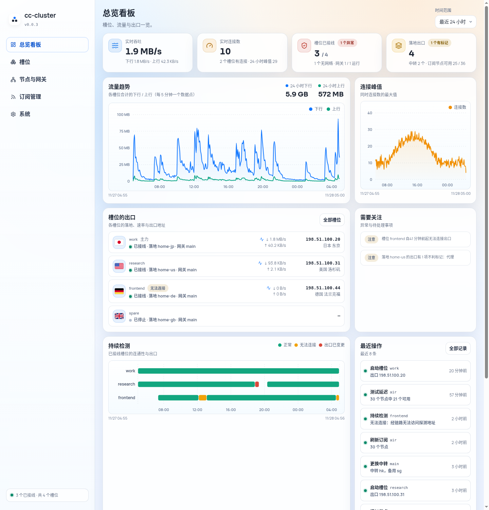
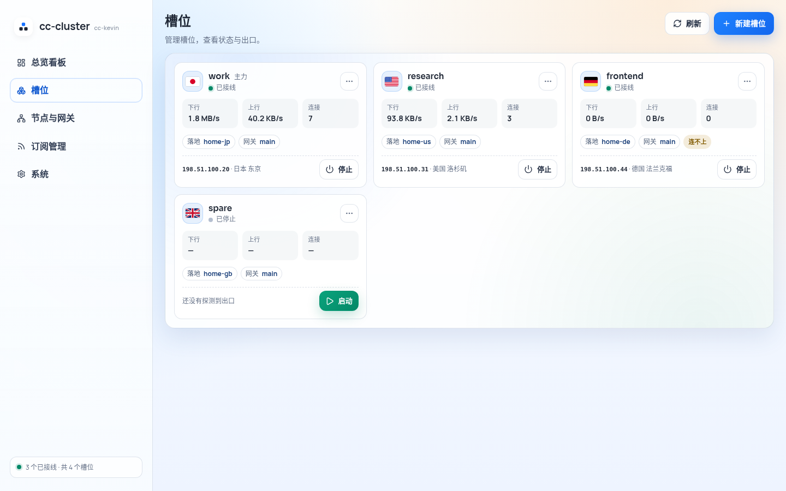
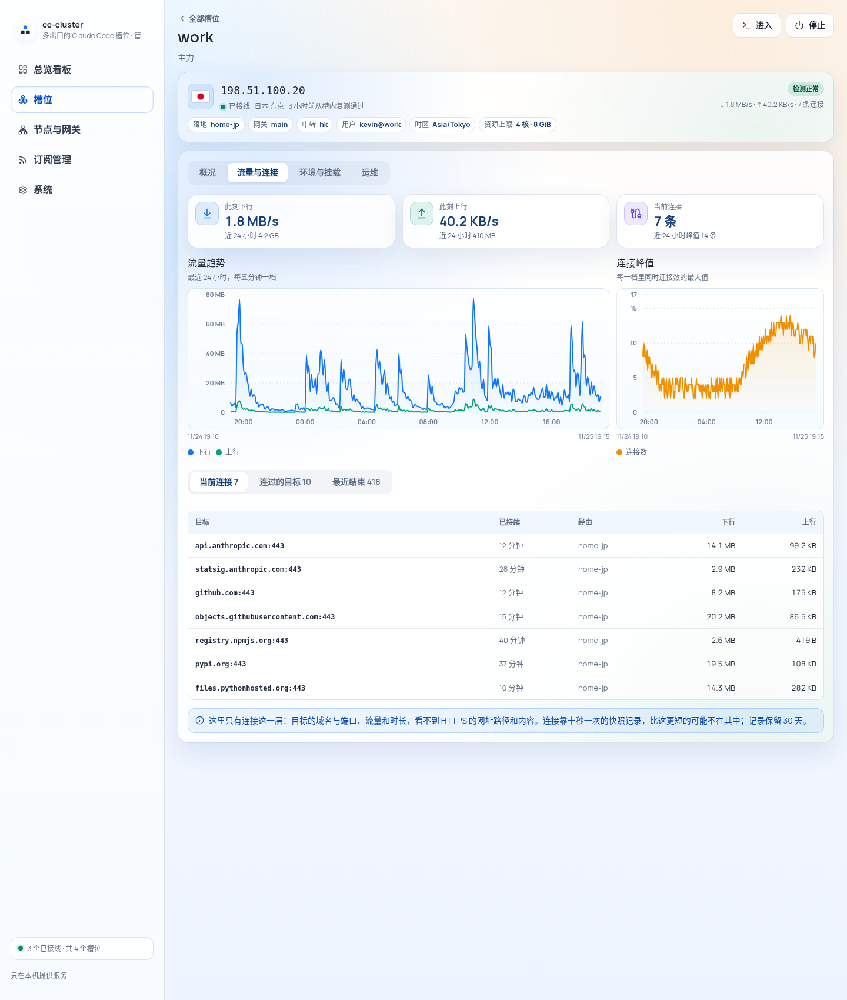
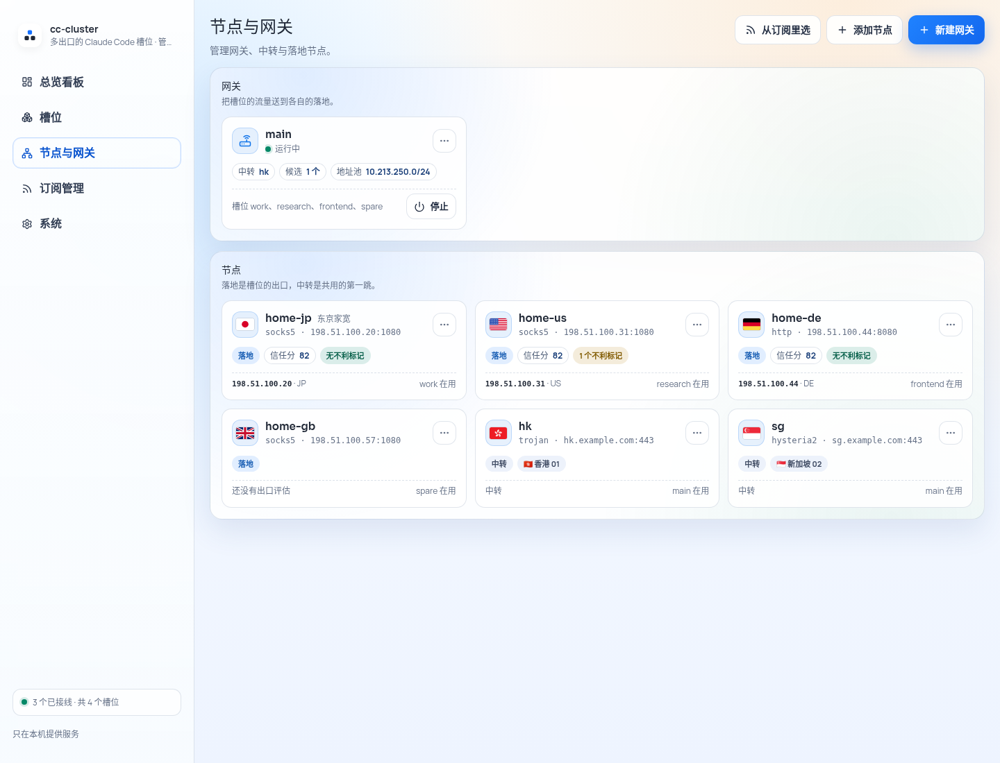
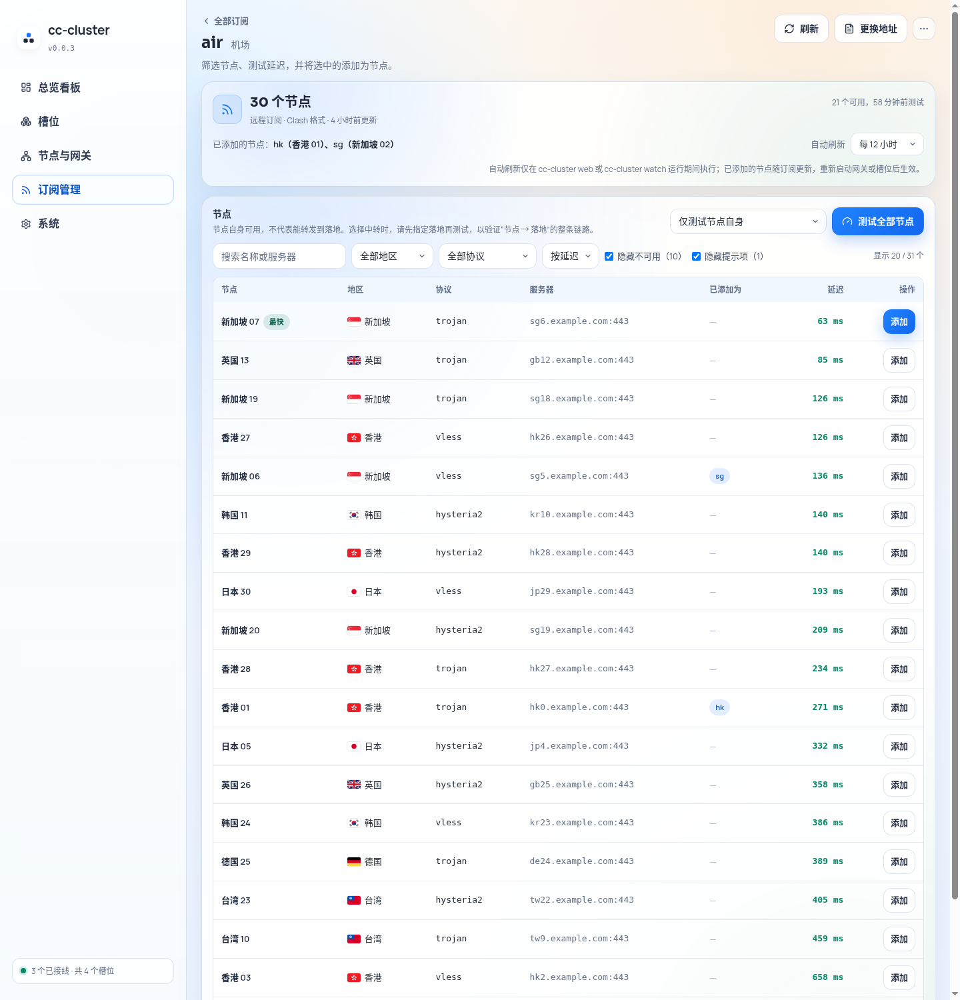

# cc-cluster

[](https://github.com/sheyestherrr/cc-cluster/actions/workflows/ci.yml)
[](https://github.com/sheyestherrr/cc-cluster/releases)
[](LICENSE)

[中文](README.md) | English

Run several independent "slots" for Claude Code on one machine. Each slot is a Docker container with its own HOME, username, hostname and machine-id, and a **fixed proxy exit**. A local web UI manages them.



- **No network by default.** A slot's container starts with `--network none`; all of its traffic is forwarded transparently by a gateway container to the exit you bound to it. If the gateway, the proxy core or the chain breaks, the slot has no network. It never falls back to a direct connection.
- **No visible proxy inside the container.** There are no `HTTPS_PROXY`-style variables and no TUN device, and programs that ignore proxy variables are covered too.
- **Docker is the only requirement.** It does not touch the host's iptables or nft rules and does not depend on a particular kernel. A normal user in the `docker` group is enough.
- **Two commands to remember.** `cc-cluster web` opens the web UI for configuration; `cc-cluster` in a project directory picks a slot and takes you into it. The full CLI is there for scripts, agents and machines without a browser.

> Docker shares the host kernel. Separate configuration and resource limits are not the same as separate physical machines, and nothing here guarantees that accounts cannot be linked. Decide for yourself whether that is enough for your use.

The web UI and the CLI output are in Chinese.

## Contents

- [Install](#install)
- [Getting started](#getting-started)
- [Screenshots](#screenshots)
- [How it works](#how-it-works)
- [Documentation](#documentation)
- [Things to know](#things-to-know)
- [License and credits](#license-and-credits)

## Install

**Requirements**: Linux and Docker (the current user must be able to run `docker` directly).

```sh
curl -fsSL https://raw.githubusercontent.com/sheyestherrr/cc-cluster/master/scripts/install.sh | sh
```

The script downloads `cc-cluster` for your platform into `~/.local/bin` (verifying its checksum), pulls the gateway and worker images, and initialises the data directory `~/.cc-cluster`. It needs no root and changes no system settings. If the data directory already exists, it only updates the binary and leaves the data directory unchanged. You can [read the script](scripts/install.sh) first.

Then check that this machine can run it (no external addresses are contacted):

```sh
cc-cluster doctor
```

<details>
<summary>Customising the install, or installing by hand</summary>

The script reads these environment variables:

| Variable | Purpose | Default |
| --- | --- | --- |
| `CC_CLUSTER_VERSION` | Version to install, e.g. `v0.0.1` | latest release |
| `CC_CLUSTER_BIN_DIR` | Where to put the binary | `~/.local/bin` |
| `CC_CLUSTER_DATA` | Data directory | `~/.cc-cluster` |
| `CC_CLUSTER_NO_INIT` | Set to `1` to skip initialising the data directory | |

Installing by hand is the same steps:

```sh
# Linux amd64 shown; Releases also has arm64 and macOS builds. Set V to the version you want.
V=v0.0.2
curl -LO https://github.com/sheyestherrr/cc-cluster/releases/download/$V/cc-cluster_${V}_linux_amd64.tar.gz
curl -LO https://github.com/sheyestherrr/cc-cluster/releases/download/$V/SHA256SUMS
sha256sum --check --ignore-missing SHA256SUMS
tar -xzf cc-cluster_${V}_linux_amd64.tar.gz
install -m 0755 cc-cluster_${V}_linux_amd64/cc-cluster ~/.local/bin/

docker pull ghcr.io/sheyestherrr/cc-cluster-gateway:$V
docker pull ghcr.io/sheyestherrr/cc-cluster-worker:$V

cc-cluster init \
  --gateway-image ghcr.io/sheyestherrr/cc-cluster-gateway:$V \
  --worker-image ghcr.io/sheyestherrr/cc-cluster-worker:$V
```

</details>

**Data directory.** Slot HOMEs, identities and node configuration live in `~/.cc-cluster` by default. To put it elsewhere, set `CC_CLUSTER_DATA=/some/dir` or pass `--data-dir` each time.

**Upgrading.** Run `cc-cluster update`. It downloads the new release, verifies its checksum and replaces only the `cc-cluster` binary: slots, nodes, subscriptions and settings are unchanged, running containers are not affected, and a web UI running in the background is restarted on the new version. The web UI shows the current version at the top of the sidebar, with an indicator dot when a newer version is available; click it to see the latest version and the release notes. `cc-cluster update --check` only checks for updates. See [CHANGELOG.md](CHANGELOG.md) for what changed in each version.

Images are not updated by default; the current ones keep working. To update them, run `cc-cluster update --images`: it pulls the new images first and changes the image setting only if the pulls succeed. Running slots then show "配置待应用" (pending) and their continuous exit checks pause; in the web UI, stop and start each gateway and use "重建 worker" (recreate worker) on each slot to apply the change. HOME and identity are kept. Do this when the slots are idle.

v0.0.2 and earlier have no `update` command: run the install command once more to upgrade (it only updates the binary and does not change the image setting), and use `cc-cluster update` from then on.

## Getting started

### 1. Configure in the web UI

```sh
cc-cluster web
```

This starts the web UI in the background and prints a local address carrying an access token. Open it in a browser.

- **Running it again** does not start a second instance; it prints the same address. Stop it with `cc-cluster web stop`.
- **The token is fixed.** After opening the tokenised address once, the same browser can use `http://127.0.0.1:7878` directly.
- **It listens on `127.0.0.1` only.** From another machine, forward the port first: `ssh -L 7878:127.0.0.1:7878 <host>`.
- **The port** defaults to 7878. If it is taken (for example by another user on the same machine) the next free port is used, so go by the printed address.
- The background process also runs the continuous exit checks, records traffic and refreshes subscriptions, so leave it running. After a reboot, run the command again (entering a slot also starts it).

Four steps in the UI get you a working slot:

1. **节点与网关 → 添加节点** (Nodes & gateways → Add node): register your landing node (a SOCKS5 or HTTP proxy). It is the slot's exit.
2. **订阅管理 → 添加订阅** (Subscriptions → Add, optional): enter a subscription URL or paste share links, test latency, and register one node as the transit. Skip this if you do not want a transit hop.
3. **节点与网关 → 新建网关** (New gateway): choose the transit from the previous step, or none.
4. **槽位 → 新建槽位 → 启动** (Slots → New slot → Start): choose the gateway and the landing node. Starting probes the chain and the exit, and the slot is only wired up if that passes. The exit address shown on the card should be your landing node.

If you have no landing node of your own, a new slot can use a subscription node as its exit directly.

### 2. Work in the terminal

You enter slots from a terminal; the web UI has no terminal. Run `cc-cluster` in a project directory:

```console
$ cd ~/projects/shop
$ cc-cluster
当前目录 /home/you/projects/shop

  1)  work      已接线  日本 东京      主力，上次使用
  2)  research  已接线  美国 洛杉矶
  3)  spare     已停止  落地 home-gb   选择后先启动
  w)  网页界面（管理槽位、节点、订阅）
  q)  退出

请选择 [1]:
进入方式：1) Claude  2) 终端 [1]:
```

It lists the slots with their state and exit, asks which one, then whether to start Claude Code or a shell. A stopped slot is started first. The last choice is remembered per directory, so next time two Enter presses take you in. The first time Claude Code is started in a slot you are asked whether to install it.

Paths inside the slot are the same as on the host, and each mount also has a shortcut of the same name under `~` (with `/home/you/project` mounted, `cd ~/project` works inside the slot). If the current directory is not mounted yet you are asked which level to mount. Your whole home directory cannot be mounted; mount specific project directories.

Every step above has a command as well (for example `cc-cluster claude work` enters slot `work` directly), meant for scripts and agents. See the [CLI documentation](docs/cli.md) (Chinese).

## Screenshots

**Slots**: one card per slot showing state, exit and current rate.



**Slot detail**: traffic over time, current connections and destinations. This is connection-level data (host, port, bytes), not the contents of HTTPS traffic.



**Nodes and gateways**: landing nodes show where the exit is and third-party assessments of that IP.



**Subscriptions**: remote subscriptions or pasted share links; filter by region and protocol, test latency, and register nodes as transit or landing.



The data in the screenshots is made up. A recent browser is required (Chrome 111, Firefox 128, Safari 16.4 or later).

## How it works

```
 slot work     (no network) ──┐
 slot research (no network) ──┼─ veth ─▶ gateway container (Mihomo TUN) ─▶ transit (optional) ─▶ landing ─▶ Internet
 slot frontend (no network) ──┘           exit chosen by source address                        one exit per slot
```

| Term | Meaning |
| --- | --- |
| **Slot** | A working environment: a worker container plus its HOME, identity and exit |
| **Landing** | The slot's exit node, the address websites see. Usually your own fixed-IP proxy |
| **Transit** | A first hop shared by several slots, usually from a subscription. Optional |
| **Gateway** | The container that forwards traffic for slots. Several slots can share one |
| **Direct exit** | Using a subscription node as the exit when you have no landing node |

The exit does not change behind your back. If the landing node is unreachable the slot has no network; it does not leave through the transit instead. If the continuous check sees the exit address change, it cuts that slot off and holds it.

## Documentation

These documents are in Chinese.

| Document | Contents |
| --- | --- |
| [CLI](docs/cli.md) | All commands: from scratch, subscriptions, daily use, direct exit, backup transits, traffic and connections, names and notes |
| [Host tmux bridge](docs/tmux-bridge.md) | Let Claude Code inside a slot drive programs on the host (optional) |
| [Architecture](ARCHITECTURE.md) | Wiring, routing and failure behaviour |
| [Building and development](docs/development.md) | Build, test, layout and branch conventions |

## Things to know

- **Re-wire after a restart.** When a worker or gateway container restarts, its link is not restored automatically. Click "启动" (Start) in the UI or run `slot up`; until then the slot has no network.
- **TCP and DNS only.** UDP and ping do not work.
- **Time zone.** If the landing node has no time zone set, the first start sets it from the detected exit location and it is not changed afterwards. If that cannot be determined, `America/Los_Angeles` is used with a warning. You can also set it on the landing node or the slot.
- **DNS is resolved on the landing side.** Inside a slot, names resolve to mapped addresses in `100.64.0.0/10`; the real resolution is done by the landing node, so the resolver seen from outside is where the landing node is.
- **Exit assessment.** Starting a slot queries third-party services once, through that slot's chain, for their view of the exit IP (datacentre, proxy and abuse flags). It is for display only and failure does not affect use. These are database opinions, not the verdict of any particular service. Turn the automatic query off on the 系统 (System) page.
- **A landing node serves at most 5 slots at a time.**
- **Slots sharing a gateway are affected together.** If the gateway's core crashes, all its slots lose network; a supervisor restarts the core and the slots recover automatically.
- **History is recorded only while the background service runs.** Traffic curves, the check timeline and connection records are written while the web UI (`cc-cluster web`, in the background by default) or `cc-cluster watch` is running. They are kept for 30 days under `history/` in the data directory and include the hosts each slot connected to. Delete that directory if you do not want them.
- **Claude Code is installed in the slot's own HOME** and persists with it. Installation and updates go out through that slot's exit.
- **Login uses your own browser.** When logging in to Claude Code inside a slot, the authorisation step happens in the browser where you open the link, over that machine's network, not through the slot's exit. Claude Code's own traffic afterwards goes through the slot's exit.
- **Hardware information.** There is no `/.dockerenv` inside a slot and DMI is masked by default. When creating a slot you can additionally override the machine model and the CPU and memory shown in `/proc` (`/proc/stat` still shows the host's core count).
- **Credentials.** Subscription URLs and node passwords are not shown again once saved. On the command line they are read from files and never appear in arguments. The data directory is mode 0700 and contains these credentials; back it up and store it with care.
- **Where it has been run.** Used for real on RHEL 8.6 and Ubuntu with real subscriptions and residential landing nodes, including installing Claude Code in a slot, logging in and daily use, and the host tmux bridge. The macOS binaries are only known to compile; they have not been run. Hosts with SELinux container labelling enabled have not been tried. Every push also runs the unit tests and an end-to-end test with fake nodes on GitHub Actions.

## License and credits

Released under the [MIT License](LICENSE).

- Special thanks to [Resin](https://github.com/Resinat/Resin) (MIT): the web UI's layout, colours, fonts and styles come from its frontend, and the overview, card-plus-detail pages and the subscription and node tables follow its design. The share-link parser is adapted from its subscription parser. The files taken, the changes and the full licence are in [web/NOTICE.md](web/NOTICE.md) and [internal/subscription/NOTICE.md](internal/subscription/NOTICE.md).
- The frontend build configuration and the behaviour of a few base components come from [Claude-Hydra](https://github.com/jin-yu-liu/Claude-Hydra) (MIT), which also informed the original UI skeleton and subscription import. See [web/NOTICE.md](web/NOTICE.md).
- Flag graphics are from [country-flag-icons](https://gitlab.com/catamphetamine/country-flag-icons) (MIT), charts use [recharts](https://github.com/recharts/recharts) (MIT), and the fonts are Sora and Manrope (SIL OFL 1.1).
- The gateway core is [Mihomo](https://github.com/MetaCubeX/mihomo).
- The host bridge uses [tmux-mcp](https://github.com/bnomei/tmux-mcp) (MIT), installed in the worker image through npm. The [tmux](https://github.com/tmux/tmux) (ISC) in the image comes from the distribution's package, or is built from the official source when you build the image locally. This repository contains none of their code.
- The package selection of the default worker image follows Claude Code's official dev container; the Dockerfile is written from scratch.

The `licenses/` directory in each release archive carries the licence notices for third-party code shipped with the binary.
