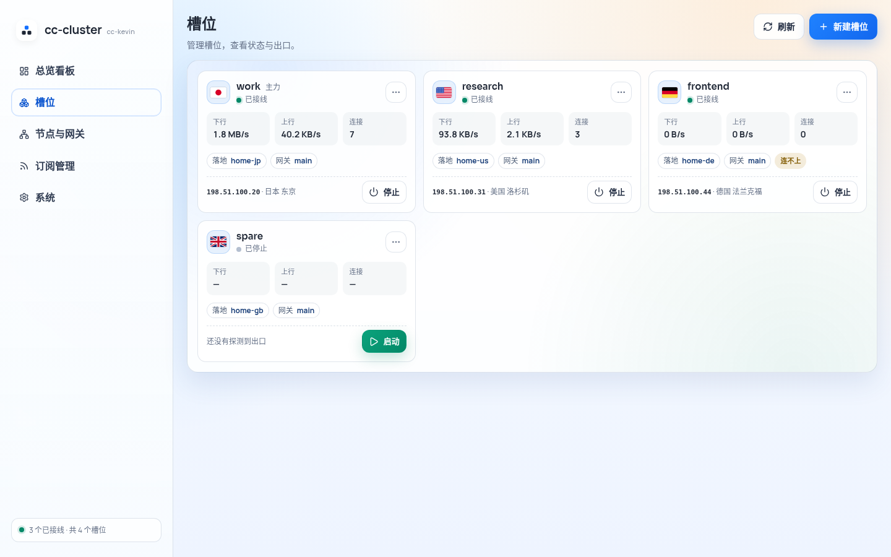
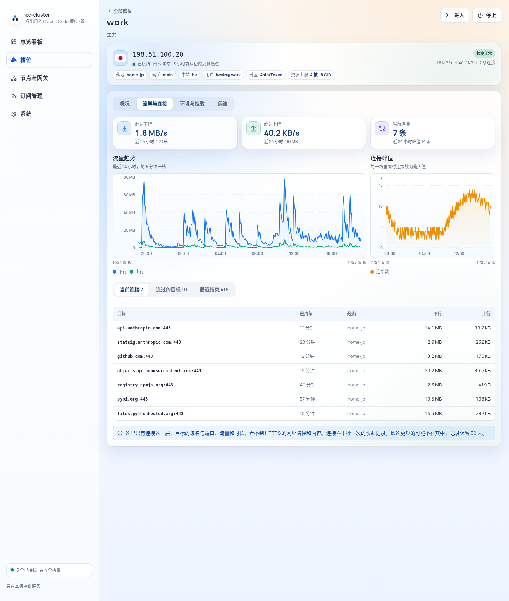
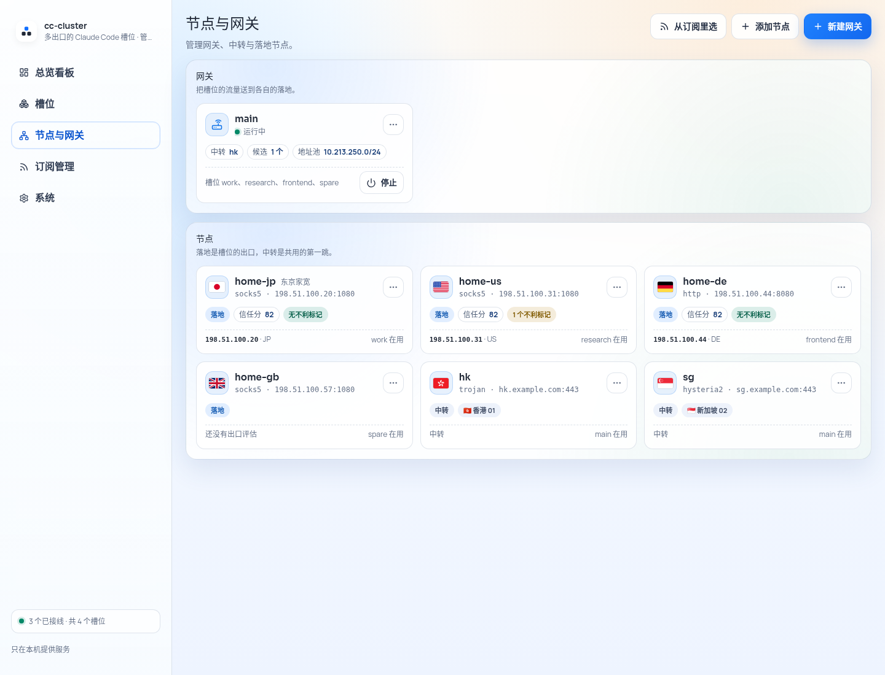

# cc-cluster

[](https://github.com/sheyestherrr/cc-cluster/actions/workflows/ci.yml)
[](https://github.com/sheyestherrr/cc-cluster/releases)
[](LICENSE)

在一台机器上给 Claude Code 开多个互不相干的“工作槽位”：每个槽位是一个 Docker 容器，有自己的 HOME、用户名、hostname、machine-id，和一个**固定的代理出口**。用一个本机的网页界面管理它们。


- **默认没有网络。** 槽位的容器以 `--network none` 启动，全部流量由一个网关容器透明转发到你给它绑定的出口。网关、核心或链路出了问题，结果是没网，不是直连。
- **容器里看不出代理。** 没有 `HTTPS_PROXY` 一类的变量，没有 TUN 网卡，不读代理变量的程序同样被接管。
- **只要求能用 Docker。** 不改宿主的 iptables / nft，不依赖特定内核版本，普通用户在 docker 组里就够。
- **一个二进制。** 网页界面、命令行、终端里的交互面板，做的是同一件事。

> Docker 共享宿主内核。独立的配置与资源限额不等于物理机级的隔离，也不能保证账号之间不被关联；请自行判断它是否满足你的需要。

## 目录

- [安装](#安装)
- [开始使用](#开始使用)
- [界面一览](#界面一览)
- [它是怎么工作的](#它是怎么工作的)
- [文档](#文档)
- [要知道的几件事](#要知道的几件事)
- [许可与致谢](#许可与致谢)

## 安装

**需要**：Linux，Docker（当前用户能直接运行 `docker`）。

```sh
curl -fsSL https://raw.githubusercontent.com/sheyestherrr/cc-cluster/master/scripts/install.sh | sh
```

脚本做四件事：下载对应平台的 `cc-cluster` 到 `~/.local/bin`（核对校验和），拉取网关与 worker 两个镜像，初始化数据目录 `~/.cc-cluster`。不需要 root，不改系统设置；重复运行会更新二进制和镜像，已有的数据目录不动。想先看它做什么，[脚本在这里](scripts/install.sh)。

装好后检查一下这台机器能否运行（不访问外部地址）：

```sh
cc-cluster doctor
```

<details>
<summary>调整安装，或者手动安装</summary>

脚本认这几个环境变量：

| 变量 | 作用 | 默认 |
| --- | --- | --- |
| `CC_CLUSTER_VERSION` | 要装的版本，如 `v0.0.1` | 最新的正式版 |
| `CC_CLUSTER_BIN_DIR` | 二进制放在哪里 | `~/.local/bin` |
| `CC_CLUSTER_DATA` | 数据目录 | `~/.cc-cluster` |
| `CC_CLUSTER_NO_INIT` | 设为 `1` 时不初始化数据目录 | |

手动安装是同样的几步：

```sh
# 以 Linux amd64 为例；Releases 里还有 arm64 和 macOS 的包。V 换成要装的版本
V=v0.0.1
curl -LO https://github.com/sheyestherrr/cc-cluster/releases/download/$V/cc-cluster_${V}_linux_amd64.tar.gz
curl -LO https://github.com/sheyestherrr/cc-cluster/releases/download/$V/SHA256SUMS
sha256sum --check --ignore-missing SHA256SUMS
tar -xzf cc-cluster_${V}_linux_amd64.tar.gz
install -m 0755 cc-cluster_${V}_linux_amd64/cc-cluster ~/.local/bin/

docker pull ghcr.io/sheyestherrr/cc-cluster-gateway:$V
docker pull ghcr.io/sheyestherrr/cc-cluster-worker:$V

cc-cluster init \
  --gateway-image ghcr.io/sheyestherrr/cc-cluster-gateway:$V \
  --worker-image ghcr.io/sheyestherrr/cc-cluster-worker:$V
```

各版本改了什么见 [CHANGELOG.md](CHANGELOG.md)。

</details>

**数据目录**（槽位的 HOME、身份、节点配置都在里面）默认是 `~/.cc-cluster`。要放到别处，设置环境变量 `CC_CLUSTER_DATA=/别的/目录`，或者每次加 `--data-dir`。

## 开始使用

```sh
cc-cluster web
```

它打印一个带一次性令牌的本机地址，在浏览器里打开。网页只监听 `127.0.0.1`；在别的机器上用，先做 SSH 端口转发：`ssh -L 7878:127.0.0.1:7878 <主机>`。

默认端口是 7878；被占用时（比如同一台机器上别的用户也在用）自动往后找一个空闲的，以打印出来的地址为准。已经在运行时再执行一次不会多开一个，只会把现有的地址再打印一遍。

在界面里走四步，就有一个能用的槽位：

1. **节点与网关 → 添加节点**：登记你的落地（SOCKS5 或 HTTP 代理），它是槽位的出口。
2. **订阅管理 → 添加订阅**（可选）：填机场的订阅地址，或者直接贴分享链接；测延迟后把一个节点登记为中转。不要中转可以跳过。
3. **节点与网关 → 新建网关**：选上一步的中转，或者不使用中转。
4. **槽位 → 新建槽位 → 启动**：选网关和落地。启动时会探测链路和出口，通过后才接线；卡片上显示的出口地址应当是你的落地。

没有自己的落地，也可以在新建槽位时直接拿订阅里的一个节点当出口（直出）。

进入槽位在终端里做，网页不提供终端：

```sh
cd ~/projects/foo
cc-cluster claude work         # 在槽位 work 里启动 Claude Code；首次会询问是否安装
cc-cluster enter work          # 或者只进入它的 shell
```

槽内的路径与宿主相同，`~` 下另有一个同名的快捷方式（挂了 `/home/you/project`，槽内 `cd ~/project` 就能进）；当前目录不在挂载范围内时会询问并挂载。整个主目录不能挂进槽位，请挂具体的项目目录。

以上每一步都有对应的命令，见[命令行文档](docs/cli.md)。

## 界面一览

**槽位**：每个槽位一张卡片，状态、出口和此刻的速率一眼可见。



**槽位详情**：流量趋势、当前的连接和连过的目标。能看到的是连接这一层（域名、端口、流量），看不到 HTTPS 的内容。



**节点与网关**：落地带出口所在地和第三方对这个 IP 的评估。



**订阅管理**：远程订阅或贴进来的分享链接；按地区和协议筛选、测延迟，把选中的登记为中转或落地。


截图里的数据是演示用的。需要较新的浏览器（Chrome 111、Firefox 128、Safari 16.4 及以上）。

## 它是怎么工作的

```
 槽位 work    （没有网络）──┐
 槽位 research（没有网络）──┼─ veth ─▶ 网关容器（Mihomo TUN）─▶ 中转（可选）─▶ 落地 ─▶ 互联网
 槽位 frontend（没有网络）──┘            按来源地址选出口                    每个槽位各自的出口
```

| 词 | 意思 |
| --- | --- |
| **槽位**（slot） | 一个工作环境：一个 worker 容器加它的 HOME、身份和出口 |
| **落地**（landing） | 槽位的出口节点，网站看到的就是它的地址。通常是你自己的固定 IP 代理 |
| **中转**（transit） | 多个槽位共用的第一跳，通常取自机场订阅；可以没有 |
| **网关**（gateway） | 替槽位转发流量的容器。多个槽位可以共用一个 |
| **直出** | 没有落地时，直接拿订阅里的一个节点当出口 |

出口不会在你不知情时变掉：落地连不上就是没网，不会改从中转出去；持续检测发现出口地址变了，会给那个槽位断网并保持。

## 文档

| 文档 | 内容 |
| --- | --- |
| [命令行](docs/cli.md) | 全部命令：从零开始、订阅、日常使用、直出、候选中转、流量与连接、名称与备注 |
| [宿主 tmux 桥接](docs/tmux-bridge.md) | 让槽内的 Claude Code 驱动宿主上的程序（可选） |
| [架构说明](ARCHITECTURE.md) | 接线、路由、故障时的行为等原理 |
| [从源码构建与开发](docs/development.md) | 构建、测试、目录结构、分支约定 |

## 要知道的几件事

- **重启后要重新接线。** worker 或网关容器重启后线不会自动接回，在界面上点“启动”（或执行 `slot up`）；在那之前该槽没有网络。
- **只代理 TCP 和 DNS。** UDP 和 ping 不通。
- **时区。** 落地没有设置时区时，首次启动按探测到的出口所在地设置，之后不再自动变动；拿不到时暂用 `America/Los_Angeles` 并提醒。也可以给落地或槽位指定。
- **域名解析在落地一侧。** 槽内解析域名得到的是 `100.64.0.0/10` 里的映射地址，真正的解析由落地去做，外部看到的解析器在落地所在地。
- **出口评估。** 启动槽位时会经该槽的链路向第三方接口查一次出口 IP 的评估（机房 / 代理 / 滥用标记），只用于展示，取不到不影响使用。它们是各家数据库的看法，不代表任何具体服务的结论。不想自动查，在“系统”页关掉。
- **一个落地最多同时接 5 个槽位。**
- **共用网关的槽位一起受影响。** 网关的核心崩溃时接在它上面的槽位一起断网，监督进程会把它拉起来，之后各槽重新启动。
- **历史只在常驻时记录。** 流量曲线、检测时间线和连接记录在 `cc-cluster web` 或 `cc-cluster watch` 运行期间记录，存在数据目录的 `history/` 下，保留 30 天；里面有各槽位访问过的域名，不想留就删掉这个目录。
- **Claude Code 装在槽位自己的 HOME 里**，随 HOME 持久化；安装与更新的访问都从该槽的出口发出。
- **登录用的是你自己的浏览器。** 在槽内登录 Claude Code 时，授权那一步在你打开链接的浏览器里完成，走的是那个浏览器所在机器的网络，不经过槽位的出口；之后 Claude Code 自己的访问都从该槽的出口发出。
- **硬件信息。** 槽内没有 `/.dockerenv`，DMI 默认被遮成空的；新建槽位时可以另外覆盖机型和 `/proc` 里的 CPU、内存显示（`/proc/stat` 仍是宿主的核数）。
- **凭据。** 订阅地址、节点密码保存之后不再显示；命令行里它们从文件读，不出现在参数上。数据目录的权限是 0700，里面有这些凭据，注意备份和保管。
- **运行过的环境。** 在 RHEL 8.6 和 Ubuntu 上用真实的订阅与家宽落地实际使用过，包括在槽内安装 Claude Code、用账号登录后日常使用、宿主 tmux 桥接。macOS 的二进制只确认过能编译出来，没有运行过；开启了 SELinux 容器标签的宿主没有试过。每次推送还会在 GitHub Actions 上跑单元测试和只用假节点的端到端测试。

## 许可与致谢

本项目以 [MIT 许可](LICENSE)发布。

- 特别感谢 [Resin](https://github.com/Resinat/Resin)（MIT）：网页界面的版面、配色、字体和样式取自它的前端，总览、卡片加详情页、订阅与节点表都是照它的做法安排的；分享链接的解析也改写自它的订阅解析器。取用的文件、改动和许可全文见 [web/NOTICE.md](web/NOTICE.md) 与 [internal/subscription/NOTICE.md](internal/subscription/NOTICE.md)。
- 前端的构建配置和几个基础组件的行为沿用自 [Claude-Hydra](https://github.com/jin-yu-liu/Claude-Hydra)（MIT），界面最初的骨架和订阅导入的做法也参考了它，见 [web/NOTICE.md](web/NOTICE.md)。
- 国旗图形来自 [country-flag-icons](https://gitlab.com/catamphetamine/country-flag-icons)（MIT），图表用 [recharts](https://github.com/recharts/recharts)（MIT），字体是 Sora 与 Manrope（SIL OFL 1.1）。
- 网关核心是 [Mihomo](https://github.com/MetaCubeX/mihomo)。
- 宿主桥接使用 [tmux-mcp](https://github.com/bnomei/tmux-mcp)（MIT），由 worker 镜像经 npm 安装；镜像里的 [tmux](https://github.com/tmux/tmux)（ISC）来自发行版的软件包，本机构建时改为从官方源码包编译。本仓库不含它们的代码。
- 默认 worker 镜像的软件包选择参考了 Claude Code 官方的开发容器，Dockerfile 为重新编写。

发布包的 `licenses/` 目录里附有随二进制分发的第三方代码的许可说明。
