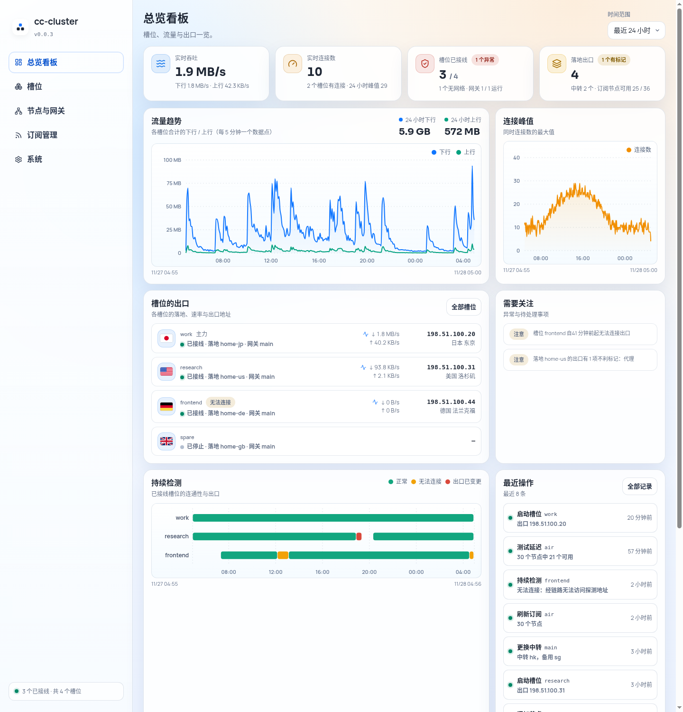
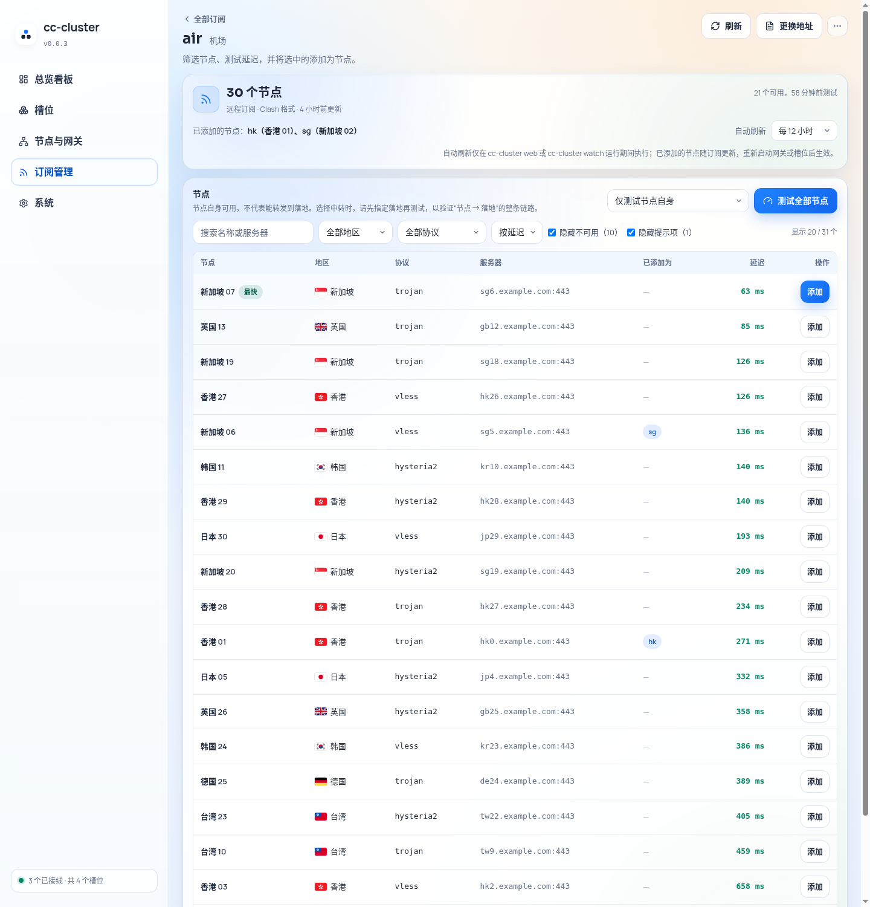

# cc-cluster

[](https://github.com/sheyestherrr/cc-cluster/actions/workflows/ci.yml)
[](https://github.com/sheyestherrr/cc-cluster/releases)
[](LICENSE)

中文 | [English](README.en.md)

在一台机器上为 Claude Code 运行多个相互独立的“工作槽位”：每个槽位是一个 Docker 容器，有独立的 HOME、用户名、hostname、machine-id 和一个**固定的代理出口**，通过本机的网页界面管理。



- **默认无网络。** 槽位的容器以 `--network none` 启动，全部流量由网关容器透明转发至该槽位绑定的出口。网关、核心或链路发生故障时，槽位断网，不会改为直连。
- **容器内没有代理的痕迹。** 没有 `HTTPS_PROXY` 等变量，没有 TUN 网卡；不读取代理变量的程序同样被接管。
- **只需要 Docker。** 不修改宿主的 iptables / nft，不依赖特定的内核版本，docker 组中的普通用户即可使用。
- **常用命令只有两个。** `cc-cluster web` 启动网页界面，用于配置；在项目目录中执行 `cc-cluster`，选择槽位后进入。完整的命令行用于脚本、agent 和无浏览器的环境。

> Docker 共享宿主内核。独立的配置与资源限额不等于物理机级的隔离，也不能保证账号之间不被关联；请自行评估是否满足需求。

## 目录

- [安装](#安装)
- [开始使用](#开始使用)
- [界面一览](#界面一览)
- [工作原理](#工作原理)
- [文档](#文档)
- [注意事项](#注意事项)
- [许可与致谢](#许可与致谢)

## 安装

**要求**：Linux、Docker（当前用户可直接运行 `docker`）。

```sh
curl -fsSL https://raw.githubusercontent.com/sheyestherrr/cc-cluster/master/scripts/install.sh | sh
```

脚本下载对应平台的 `cc-cluster` 到 `~/.local/bin`（验证校验和），拉取网关与 worker 两个镜像，并初始化数据目录 `~/.cc-cluster`。不需要 root，不修改系统设置；数据目录已存在时只更新二进制，不修改数据目录。可先[查看脚本内容](scripts/install.sh)。

安装后检查本机的运行环境（不访问外部地址）：

```sh
cc-cluster doctor
```

<details>
<summary>安装选项与手动安装</summary>

脚本支持以下环境变量：

| 变量 | 作用 | 默认值 |
| --- | --- | --- |
| `CC_CLUSTER_VERSION` | 安装的版本，如 `v0.0.1` | 最新正式版 |
| `CC_CLUSTER_BIN_DIR` | 二进制的安装目录 | `~/.local/bin` |
| `CC_CLUSTER_DATA` | 数据目录 | `~/.cc-cluster` |
| `CC_CLUSTER_NO_INIT` | 设为 `1` 时不初始化数据目录 | |

手动安装的步骤相同：

```sh
# 以 Linux amd64 为例；Releases 中另有 arm64 与 macOS 的安装包。将 V 改为要安装的版本
V=v0.0.2
curl -LO https://github.com/sheyestherrr/cc-cluster/releases/download/$V/cc-cluster_${V}_linux_amd64.tar.gz
curl -LO https://github.com/sheyestherrr/cc-cluster/releases/download/$V/SHA256SUMS
sha256sum --check --ignore-missing SHA256SUMS
tar -xzf cc-cluster_${V}_linux_amd64.tar.gz
install -m 0755 cc-cluster_${V}_linux_amd64/cc-cluster ~/.local/bin/

docker pull ghcr.io/sheyestherrr/cc-cluster-gateway:$V
docker pull ghcr.io/sheyestherrr/cc-cluster-worker:$V

cc-cluster init \
  --gateway-image ghcr.io/sheyestherrr/cc-cluster-gateway:$V \
  --worker-image ghcr.io/sheyestherrr/cc-cluster-worker:$V
```

各版本的变更见 [CHANGELOG.md](CHANGELOG.md)。

</details>

**数据目录**保存槽位的 HOME、身份与节点配置，默认为 `~/.cc-cluster`；可用环境变量 `CC_CLUSTER_DATA` 或参数 `--data-dir` 指定其他目录。

**升级**：执行 `cc-cluster update`。它下载新版本并验证校验和，然后只替换 `cc-cluster` 二进制文件：槽位、节点、订阅与设置不变，运行中的容器不受影响，后台运行的网页界面自动重启为新版本。网页侧栏左上角显示当前版本，有新版本时版本号旁出现提示点；点击版本号可查看最新版本与更新说明。`cc-cluster update --check` 仅检查，不安装。各版本的变更见 [CHANGELOG.md](CHANGELOG.md)。

镜像默认不随 `cc-cluster` 更新，现有镜像可继续使用。需要更新镜像时执行 `cc-cluster update --images`：先拉取新版本的镜像，成功后再修改镜像设置。此后运行中的槽位显示“配置待应用”，其持续检测暂停；在网页中将网关停止后重新启动，并对槽位执行“重建 worker”后生效（HOME 与身份保留）。建议在槽位空闲时进行。

v0.0.2 及更早的版本没有 `update` 命令，请重新运行安装命令完成升级（只更新二进制，不修改镜像设置），之后使用 `cc-cluster update`。

## 开始使用

### 1. 在网页界面中配置

```sh
cc-cluster web
```

该命令在后台启动网页界面，并输出带访问令牌的本机地址，请在浏览器中打开。

- **重复执行**不会启动第二个实例，只再次输出同一地址。停止：`cc-cluster web stop`。
- **令牌固定不变**：用带令牌的地址打开一次后，同一浏览器可直接访问 `http://127.0.0.1:7878`。
- **只监听 `127.0.0.1`**：从其他机器访问时，先建立 SSH 端口转发：`ssh -L 7878:127.0.0.1:7878 <主机>`。
- **端口**默认为 7878；被占用时（例如同一台机器上的其他用户也在使用）自动改用后面的空闲端口，以输出的地址为准。
- 网页界面运行期间还执行持续检测、记录流量并定时刷新订阅，建议保持运行。机器重启后需重新执行（进入槽位时也会自动启动）。

在界面中完成以下四步，即可得到一个可用的槽位：

1. **节点与网关 → 添加节点**：添加落地（SOCKS5 或 HTTP 代理），即槽位的出口。
2. **订阅管理 → 添加订阅**（可选）：填写订阅地址，或粘贴分享链接；测试延迟后，将一个节点添加为中转。不使用中转时可跳过。
3. **节点与网关 → 新建网关**：选择上一步的中转，或不使用中转。
4. **槽位 → 新建槽位 → 启动**：选择网关与落地。启动时探测链路与出口，通过后才接线；卡片上显示的出口地址应为落地的地址。

没有落地时，可在新建槽位时直接以订阅中的一个节点为出口（直出）。

### 2. 在终端中使用

进入槽位需在终端中操作，网页界面不提供终端。在项目目录中执行 `cc-cluster`：

```console
$ cd ~/projects/shop
$ cc-cluster
当前目录 /home/you/projects/shop

  1)  work      已接线  日本 东京      主力，上次使用
  2)  research  已接线  美国 洛杉矶
  3)  spare     已停止  落地 home-gb   选择后先启动
  w)  网页界面（管理槽位、节点、订阅）
  q)  退出

请选择 [1]:
进入方式：1) Claude  2) 终端 [1]:
```

每个目录上次的选择会被保存，下次按两次回车即可进入。首次在槽位中启动 Claude Code 时询问是否安装。

槽内的路径与宿主相同，`~` 下另有同名的快捷方式（挂载 `/home/you/project` 后，槽内可用 `cd ~/project` 进入）；当前目录不在挂载范围内时询问是否挂载。主目录不能整个挂载，请挂载具体的项目目录。

以上各步均有对应的命令（例如 `cc-cluster claude work` 直接进入槽位 work），可用于脚本和 agent，见[命令行文档](docs/cli.md)。

## 界面一览

**槽位**：每个槽位一张卡片，显示状态、出口与当前速率。


**槽位详情**：流量趋势、当前连接与访问过的目标。只显示连接层的信息（域名、端口、流量），不包含 HTTPS 的内容。


**节点与网关**：落地显示出口所在地与第三方对该 IP 的评估。


**订阅管理**：远程订阅或粘贴的分享链接；可按地区与协议筛选、测试延迟，并将选中的节点添加为中转或落地。



截图中为演示数据。需要较新的浏览器（Chrome 111、Firefox 128、Safari 16.4 及以上）。

## 工作原理

```
 槽位 work    （没有网络）──┐
 槽位 research（没有网络）──┼─ veth ─▶ 网关容器（Mihomo TUN）─▶ 中转（可选）─▶ 落地 ─▶ 互联网
 槽位 frontend（没有网络）──┘            按来源地址选出口                    每个槽位各自的出口
```

| 术语 | 含义 |
| --- | --- |
| **槽位**（slot） | 一个工作环境：worker 容器及其 HOME、身份与出口 |
| **落地**（landing） | 槽位的出口节点，目标网站看到的是它的地址；通常是自有的固定 IP 代理 |
| **中转**（transit） | 多个槽位共用的第一跳，通常取自订阅；可选 |
| **网关**（gateway） | 为槽位转发流量的容器，可由多个槽位共用 |
| **直出** | 没有落地时，直接以订阅中的一个节点为出口 |

出口不会自行变更：落地无法连接时槽位断网，不会改由中转直接出站；持续检测发现出口地址变更时，将该槽位断网并保持。

## 文档

| 文档 | 内容 |
| --- | --- |
| [命令行](docs/cli.md) | 全部命令：快速开始、订阅、日常使用、直出、备用中转、流量与连接、名称与备注 |
| [宿主 tmux 桥接](docs/tmux-bridge.md) | 使槽内的 Claude Code 可操作宿主上的程序（可选） |
| [架构说明](ARCHITECTURE.md) | 接线、路由、故障时的行为等原理 |
| [从源码构建与开发](docs/development.md) | 构建、测试、目录结构、分支约定 |

## 注意事项

- **重启后需重新接线。** worker 或网关容器重启后不会自动接线，需在界面上点击“启动”（或执行 `slot up`）；在此之前该槽位无网络。
- **只代理 TCP 与 DNS。** 不支持 UDP 与 ping。
- **时区。** 落地未设置时区时，首次启动按出口所在地设置，之后不再自动变更；无法探测时暂用 `America/Los_Angeles` 并给出提醒。也可为落地或槽位指定时区。
- **域名解析在落地一侧。** 槽内解析域名得到的是 `100.64.0.0/10` 中的映射地址，实际的解析由落地完成，外部看到的解析器位于落地所在地。
- **出口评估。** 启动槽位时经该槽位的链路向第三方接口查询一次出口 IP 的评估（机房、代理、滥用标记），仅用于展示，查询失败不影响使用。评估结果来自各第三方数据库，不代表任何具体服务的判断。可在“系统”页关闭自动查询。
- **一个落地最多同时供 5 个槽位使用。**
- **共用网关的槽位同时受影响。** 网关的核心崩溃时，该网关上的槽位同时断网；监督脚本重启核心后自动恢复。
- **历史仅在后台服务运行期间记录。** 流量曲线、检测时间线与连接记录在网页界面（`cc-cluster web`，默认在后台运行）或 `cc-cluster watch` 运行期间记录，保存在数据目录的 `history/` 下，保留 30 天；其中包含各槽位访问过的域名，不需要保留时可删除该目录。
- **Claude Code 安装在槽位的 HOME 中**，随 HOME 保留；安装与更新的访问均经该槽位的出口发出。
- **登录在浏览器中完成。** 在槽内登录 Claude Code 时，授权步骤在打开链接的浏览器中完成，使用该浏览器所在机器的网络，不经过槽位的出口；此后 Claude Code 自身的访问均经该槽位的出口发出。
- **硬件信息。** 槽内没有 `/.dockerenv`，DMI 默认屏蔽为空；新建槽位时可另行覆盖机型以及 `/proc` 中的 CPU、内存显示（`/proc/stat` 仍为宿主的核数）。
- **凭据。** 订阅地址与节点密码保存后不再显示；命令行从文件读取，不出现在参数中。数据目录的权限为 0700，其中包含这些凭据，请妥善备份与保管。
- **已验证的环境。** 已在 RHEL 8.6 与 Ubuntu 上使用真实的订阅与家宽落地实际运行，包括在槽内安装 Claude Code、登录账号后日常使用以及宿主 tmux 桥接。macOS 的二进制仅确认可以编译，未实际运行；启用 SELinux 容器标签的宿主未经测试。每次推送均在 GitHub Actions 上运行单元测试和仅使用模拟节点的端到端测试。

## 许可与致谢

本项目以 [MIT 许可](LICENSE)发布。

- 特别感谢 [Resin](https://github.com/Resinat/Resin)（MIT）：网页界面的版面、配色、字体和样式取自它的前端，总览、卡片加详情页、订阅与节点表都是照它的做法安排的；分享链接的解析也改写自它的订阅解析器。取用的文件、改动和许可全文见 [web/NOTICE.md](web/NOTICE.md) 与 [internal/subscription/NOTICE.md](internal/subscription/NOTICE.md)。
- 前端的构建配置和几个基础组件的行为沿用自 [Claude-Hydra](https://github.com/jin-yu-liu/Claude-Hydra)（MIT），界面最初的骨架和订阅导入的做法也参考了它，见 [web/NOTICE.md](web/NOTICE.md)。
- 国旗图形来自 [country-flag-icons](https://gitlab.com/catamphetamine/country-flag-icons)（MIT），图表用 [recharts](https://github.com/recharts/recharts)（MIT），字体是 Sora 与 Manrope（SIL OFL 1.1）。
- 网关核心是 [Mihomo](https://github.com/MetaCubeX/mihomo)。
- 宿主桥接使用 [tmux-mcp](https://github.com/bnomei/tmux-mcp)（MIT），由 worker 镜像经 npm 安装；镜像里的 [tmux](https://github.com/tmux/tmux)（ISC）来自发行版的软件包，本机构建时改为从官方源码包编译。本仓库不含它们的代码。
- 默认 worker 镜像的软件包选择参考了 Claude Code 官方的开发容器，Dockerfile 为重新编写。

发布包的 `licenses/` 目录里附有随二进制分发的第三方代码的许可说明。
